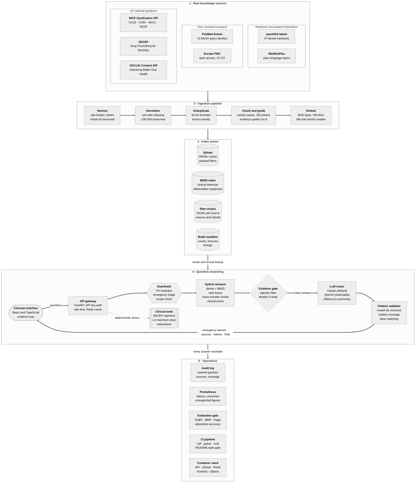

# Root Canon AI

**Evidence grounded clinical decision support for UK dental surgery, built on retrieval augmented generation over real, licensed clinical knowledge.**

## System architecture




The architecture is organised into five layers, numbered in the diagram in the order data flows through them.

**1 · Real knowledge sources.** Every document comes from a public, authoritative API: NICE guidance through the NICE Syndication API, SDCEP prescribing guidance, Delivering Better Oral Health through the GOV.UK Content API, peer reviewed research from PubMed and Europe PMC, US drug labels from openFDA, and patient information from MedlinePlus. Nothing in the knowledge base is synthetic.

**2 · Ingestion pipeline.** Connectors harvest each source politely (rate limits, retries with exponential backoff, robots.txt for HTML sources) and checkpoint raw JSONL so a run can resume. Documents are normalised without destroying clinical tokens such as 1:80,000 or 1,450 ppm, collapsed with 64 bit SimHash deduplication, chunked within section boundaries, graded for strength of evidence and embedded.

**3 · Index stores.** Qdrant holds dense vectors with payload indexes for source type, jurisdiction and evidence level. A BM25 index with a clinical tokenizer covers the exact terms dense models blur (drug names, ratios, guideline codes). A build manifest records counts, licences and timings for provenance.

**4 · Question answering.** A question passes through redaction, emergency triage and scope checks before hybrid retrieval, an evidence gate, generation by the selected model and citation validation. Results stream back to the clinician as typed server sent events. Doses and other numbers that could harm a patient are served by deterministic tools, never invented by the model.

**5 · Operations.** Every answer is audited without storing patient text, measured in Prometheus, and the evaluation suite runs as a gate in continuous integration.

A static poster version of the same architecture is kept at `docs/architecture.svg` for slides and printed material, and the diagram source lives at `docs/architecture.mmd`.

## Interactive demo

**[Open the Root Canon AI interactive demo](https://claude.ai/artifact/6Ao4tLaBPz3e4LNRPyvjuX)**

The demo is a single page that runs entirely in the browser on the bundled UK guidance seed set. It performs real BM25 retrieval over chunked guidance, applies the same redaction, emergency triage and scope rules as the backend, composes an extractive answer in which every sentence carries a numbered citation, and checks every clinical figure against the cited source. The clinical tools tab exposes the deterministic regimen lookup, local anaesthetic ceiling, adrenaline dosing by age and interaction checker.

Try these to see each safety layer at work:

* *Patient on apixaban twice daily needs a surgical extraction. What should they do with their dose?* shows UK guidance retrieved and cited ahead of research.
* *Amoxicillin dose for a dental abscess in a 3 year old* shows the paediatric dosing band.
* The urgent example consult shows the NHS number and name being redacted and the anaphylaxis banner appearing before the answer.

Because the hosted demo has no server, it writes extractive summaries. The deployed service writes the answer with Claude (or OpenAI, or a local Ollama model) under exactly the same citation checks. The demo page is rebuilt from the real corpus with `make demo_build`.

## Project brief

A general dental practitioner in the United Kingdom makes dozens of decisions a day that depend on guidance they cannot hold in their head: which antibiotic is now first choice after the 2021 SDCEP update, how a patient on a direct oral anticoagulant should time their dose before an extraction, whether a patient with a prosthetic valve needs prophylaxis, what fluoride concentration a two year old should use. The answers exist, but they are scattered across NICE guidelines, SDCEP publications, the Delivering Better Oral Health toolkit, the BNF and thousands of research papers, and the practitioner usually has a patient in the chair while looking for them.

General purpose chatbots are a poor fit for this. They answer fluently from training data of unknown date and provenance, they can state a plausible but wrong dose with full confidence, and they give no way to check where a claim came from. In clinical work an unverifiable answer is not a time saving; it is a liability, because the clinician remains professionally accountable to the General Dental Council for every decision.

Root Canon AI is designed around that accountability. It answers only from a curated, licence tracked knowledge base of real UK guidance and peer reviewed evidence, ties every factual sentence to a numbered source the clinician can open, ranks UK national guidance above research and research above foreign drug labels, refuses to answer when the evidence is too thin, and moves every safety critical number (doses, maximum anaesthetic volumes, emergency drug doses) out of the language model into deterministic, version controlled tools. The name reflects the goal: an assistant rooted in the clinical canon, not in the model's memory.

## What Root Canon AI does

* **Cited clinical answers.** Questions about prescribing, medically compromised patients, prevention, oral medicine referrals and emergencies are answered in British English with an inline citation on every factual sentence.
* **Emergency first triage.** Descriptions of anaphylaxis, collapse, airway obstruction, chest pain, seizures, hypoglycaemia, spreading infection or uncontrolled bleeding trigger an immediate action banner based on Resuscitation Council UK guidance, sent as the first streamed event before any retrieval.
* **Deterministic clinical tools.** SDCEP regimens with paediatric age bands, local anaesthetic maximum dose by weight with absolute ceilings, intramuscular adrenaline dose by age, and a curated interaction checker for the medicines dentists most often prescribe.
* **Evidence visibility.** Each source shows its evidence grade on a six step ladder from ungraded to UK national guidance, its section, year and jurisdiction.
* **Patient data protection.** Names with titles, valid NHS numbers (checked with the modulus 11 algorithm), postcodes, dates of birth, phone numbers and email addresses are redacted before any text reaches retrieval, a model vendor, a cache or a log.
* **Model choice.** Claude through the Anthropic API is the default; OpenAI and a fully local Ollama model can be selected per deployment or per request.

## The knowledge base

<table>
  <thead>
    <tr><th>Source</th><th>What is ingested</th><th>Access</th><th>Licence handling</th><th>Role in answers</th></tr>
  </thead>
  <tbody>
    <tr><td>NICE</td><td>CG19 dental recall, CG64 endocarditis prophylaxis, NG12 suspected cancer, NG30 and NG48 oral health, NG15 antimicrobial stewardship</td><td>NICE Syndication API</td><td>Syndication licence key required</td><td>Highest priority UK guidance</td></tr>
    <tr><td>SDCEP</td><td>Drug Prescribing for Dentistry, anticoagulant and MRONJ guidance, medical emergency drugs</td><td>Polite HTML harvest honouring robots.txt</td><td>Terms reviewed before redistribution</td><td>Highest priority UK guidance</td></tr>
    <tr><td>GOV.UK</td><td>Delivering Better Oral Health toolkit chapters</td><td>GOV.UK Content API</td><td>Open Government Licence v3.0</td><td>Highest priority UK guidance</td></tr>
    <tr><td>Europe PMC</td><td>Open access dental full text articles</td><td>Europe PMC REST API with cursor paging</td><td>Only CC BY and CC0 records retained</td><td>Research evidence with full text</td></tr>
    <tr><td>PubMed</td><td>Abstracts across ten dental MeSH query families, systematic reviews and trials fetched first</td><td>NCBI Entrez with history server batching</td><td>Abstracts indexed under fair dealing</td><td>Research evidence, graded by publication type</td></tr>
    <tr><td>openFDA</td><td>Structured product labels for 37 medicines relevant to dentistry</td><td>openFDA drug label API</td><td>US public domain</td><td>Pharmacology and interactions, never UK doses</td></tr>
    <tr><td>MedlinePlus</td><td>Plain language dental and oral health topics</td><td>NLM web service</td><td>US public domain</td><td>Patient facing explanations</td></tr>
  </tbody>
</table>

The PubMed query families alone (caries and prevention, periodontology, endodontics, oral surgery, implantology, restorative dentistry, oral medicine, dental pharmacology, paediatric dentistry and medically compromised patients) return several hundred thousand records with abstracts, which is why the pipeline streams to disk and indexes in batches rather than holding the corpus in memory. Systematic reviews, meta analyses, randomised trials and practice guidelines are harvested in a priority pass so that a capped run still indexes the strongest evidence first.

A hand checked seed set of sixteen UK guidance summaries ships with the repository. Each summary is written in our own words, points at its authoritative public URL and was checked against that source. It lets the service start, the tests run and the demo work before the full harvest has been run.

Evidence is graded on a six step scale used for both ranking and display:

<table>
  <thead><tr><th>Grade</th><th>Meaning</th><th>Typical source</th></tr></thead>
  <tbody>
    <tr><td>6</td><td>UK national guidance</td><td>NICE, SDCEP, Delivering Better Oral Health, Resuscitation Council UK</td></tr>
    <tr><td>5</td><td>Systematic review or meta analysis</td><td>Cochrane Oral Health reviews</td></tr>
    <tr><td>4</td><td>Randomised controlled trial</td><td>PubMed records typed as trials</td></tr>
    <tr><td>3</td><td>Observational or regulatory</td><td>Cohort studies, US drug labels</td></tr>
    <tr><td>2</td><td>Case report or series</td><td>Case reports</td></tr>
    <tr><td>1</td><td>Expert opinion or narrative review</td><td>Narrative reviews, patient information</td></tr>
  </tbody>
</table>

## How a question is answered

1. **Redaction.** Identifiers are replaced with typed placeholders. Nothing identifiable leaves the service.
2. **Emergency triage.** Pattern rules for eight emergency categories run first. A match streams an action banner immediately and adds emergency guidance hints to the retrieval query.
3. **Scope check.** Questions with no dental or dentally relevant medical content are declined politely without spending a model call. Short follow up questions inherit scope from the conversation.
4. **Hybrid retrieval.** The query is embedded with BGE base and searched in Qdrant (top 40) while BM25 searches the same corpus (top 40). Results are fused with reciprocal rank fusion, reranked by a cross encoder, then rescored with an evidence prior, a recency prior with an eight year half life and a UK jurisdiction bonus. No document may fill more than two of the eight context slots.
5. **Injection filter and evidence gate.** Retrieved text that tries to instruct the model is dropped. If the best remaining evidence scores below the threshold the system abstains instead of guessing.
6. **Generation.** Sources are passed as numbered XML blocks carrying title, evidence grade, year and jurisdiction. The system prompt, cached at the provider, requires a citation on every factual sentence, forbids doses not present verbatim in a source and requires a closing clinical judgement line.
7. **Citation validation.** Citations to ids that were never supplied are removed, sentence level citation coverage is measured, and every number with a clinical unit in the answer must appear in a cited source. Unmatched figures are flagged to the clinician in the answer itself.
8. **Audit.** A record with a hash of the question, the sources used, coverage, provider and latency is appended to the audit log.

## Clinical safety design

<table>
  <thead><tr><th>Risk</th><th>Control</th><th>Where it lives</th></tr></thead>
  <tbody>
    <tr><td>Invented or outdated dose</td><td>Doses served by deterministic tools from a reviewed formulary file; generated figures checked against cited sources</td><td><code>backend/app/clinical</code>, <code>backend/app/generation/citations.py</code></td></tr>
    <tr><td>Unverifiable claim</td><td>Mandatory inline citations, invalid ids stripped, coverage measured and displayed</td><td><code>backend/app/generation</code></td></tr>
    <tr><td>Answering beyond the evidence</td><td>Evidence gate and explicit abstention token, mapped to a safe message</td><td><code>backend/app/generation/rag_pipeline.py</code></td></tr>
    <tr><td>Delay in an emergency</td><td>Triage before retrieval; banner sent as the first streamed event</td><td><code>backend/app/guardrails/emergency.py</code></td></tr>
    <tr><td>Patient data leaving the practice</td><td>Redaction before retrieval, model calls, cache and logs; Ollama option for fully local inference</td><td><code>backend/app/guardrails/pii.py</code></td></tr>
    <tr><td>Prompt injection through documents</td><td>Sources marked as data in the prompt and injected chunks dropped</td><td><code>backend/app/guardrails/scope.py</code></td></tr>
    <tr><td>Foreign practice presented as UK standard</td><td>Jurisdiction tagging, UK ranking bonus and prompt rule to prefer UK guidance</td><td><code>backend/app/retrieval/hybrid.py</code></td></tr>
  </tbody>
</table>

Root Canon AI is decision support for registered dental professionals. It does not diagnose individual patients, it is not a medical device, and it does not replace the BNF, the BNFC or professional judgement. A deployment that will be used in patient care should complete a DCB0129 clinical safety case and a data protection impact assessment.

## Evaluation

The evaluation suite in `evaluation/golden_set.jsonl` holds twenty real UK clinical questions across prescribing, analgesia, cardiology, prevention, emergencies, medically compromised patients and oral medicine, plus deliberately unanswerable questions that test abstention. Each question names the source that should be retrieved and the facts the answer should contain.

Offline baseline, measured on the seed set with the hashing embedder and the extractive generator, which is the configuration continuous integration runs without network access:

<table>
  <thead><tr><th>Metric</th><th>Result</th><th>CI gate</th></tr></thead>
  <tbody>
    <tr><td>Retrieval hit at 5</td><td>1.000</td><td>at least 0.90</td></tr>
    <tr><td>Retrieval mean reciprocal rank</td><td>0.935</td><td>reported</td></tr>
    <tr><td>Expected fact recall</td><td>0.824</td><td>reported</td></tr>
    <tr><td>Citation coverage</td><td>1.000</td><td>at least 0.90</td></tr>
    <tr><td>Answers with an unsupported figure</td><td>0.000</td><td>must be 0</td></tr>
    <tr><td>Emergency triage accuracy</td><td>1.000</td><td>must be 1.0</td></tr>
    <tr><td>Abstention accuracy</td><td>0.900</td><td>reported</td></tr>
  </tbody>
</table>

The two abstention misses are the expected weakness of the extractive generator, which always summarises whatever was retrieved. With Claude generating, the system prompt's abstention rule handles these cases, and `make eval_live` produces the same report against the live index and model for comparison.

## Repository layout

```text
RootCanonAI
├── backend/app
│   ├── api/                 routes, schemas, auth, rate limiting, container
│   ├── clinical/            deterministic tools and the UK dental formulary
│   ├── generation/          prompts, RAG pipeline, citation validator
│   ├── guardrails/          emergency triage, PII redaction, scope and injection
│   ├── llm/                 Anthropic, OpenAI and Ollama providers, factory
│   ├── observability/       Prometheus metrics
│   ├── retrieval/           embedder, BM25, vector stores, reranker, hybrid
│   ├── config.py            typed settings
│   ├── domain.py            documents, chunks, evidence grades, licences
│   └── main.py              FastAPI application factory
├── ingestion
│   ├── config/              corpus definition: queries, drugs, guidance ids
│   ├── processing/          cleaner, chunker, evidence grader, SimHash dedup
│   ├── sources/             PubMed, Europe PMC, NICE, SDCEP, GOV.UK, openFDA, MedlinePlus
│   ├── pipeline.py          harvest, deduplicate, chunk, embed, index
│   ├── seed.py              hand checked UK guidance seed set
│   └── cli.py               ingest, seed and stats commands
├── evaluation/              golden questions and the evaluation harness
├── frontend/                React and TypeScript clinician interface
├── demo/                    standalone interactive demo and its template
├── docs/                    architecture diagram source and poster
├── scripts/                 demo and diagram builders
├── tests/                   unit, pipeline and API tests
├── compose.yaml             API, Qdrant, Redis, frontend, Ollama, Prometheus
└── Makefile                 every common task
```

## Getting started

Requirements are Python 3.11 or newer, Node 22 and Docker for the full stack.

```bash
cp .env.example .env          # add ANTHROPIC_API_KEY
make install                  # Python and frontend dependencies
make seed                     # index the UK guidance seed set in seconds
make serve                    # API on port 8000
make frontend                 # interface on port 5173
```

To build the full knowledge base and run the complete stack:

```bash
make up                       # API, Qdrant, Redis and the interface in containers
make ingest                   # harvest every source into Qdrant (several hours)
make ingest_quick             # a capped harvest for development
make test                     # unit, pipeline and API tests with coverage
make eval                     # offline evaluation report
```

Without an API key the service still runs end to end using the extractive generator, which makes local development and testing possible offline.

## Configuration

All settings are environment variables with the `RC_` prefix, read by `backend/app/config.py`. The most important are:

<table>
  <thead><tr><th>Variable</th><th>Default</th><th>Purpose</th></tr></thead>
  <tbody>
    <tr><td><code>RC_LLM_PROVIDER</code></td><td>anthropic</td><td>anthropic, openai or ollama</td></tr>
    <tr><td><code>RC_ANTHROPIC_MODEL</code></td><td>Claude Sonnet 5.5</td><td>Claude model used for generation</td></tr>
    <tr><td><code>RC_OLLAMA_MODEL</code></td><td>llama3.1:8b</td><td>local model for on premises deployments</td></tr>
    <tr><td><code>RC_EMBEDDING_MODEL</code></td><td>BGE base</td><td>dense embedding model</td></tr>
    <tr><td><code>RC_RERANKER_MODEL</code></td><td>BGE reranker base</td><td>cross encoder used for reranking</td></tr>
    <tr><td><code>RC_TOP_K_FINAL</code></td><td>8</td><td>passages passed to the model</td></tr>
    <tr><td><code>RC_MIN_EVIDENCE_SCORE</code></td><td>0.20</td><td>below this the system abstains</td></tr>
    <tr><td><code>RC_EVIDENCE_WEIGHT</code></td><td>0.15</td><td>weight of the evidence grade in ranking</td></tr>
    <tr><td><code>RC_RECENCY_HALF_LIFE_YEARS</code></td><td>8</td><td>recency decay for research</td></tr>
    <tr><td><code>NCBI_API_KEY</code></td><td>empty</td><td>raises PubMed throughput from 3 to 10 requests per second</td></tr>
    <tr><td><code>NICE_SYNDICATION_API_KEY</code></td><td>empty</td><td>enables the NICE connector</td></tr>
  </tbody>
</table>

## API reference

<table>
  <thead><tr><th>Method</th><th>Path</th><th>Purpose</th></tr></thead>
  <tbody>
    <tr><td>POST</td><td><code>/v1/ask</code></td><td>Complete cited answer with sources, coverage and safety flags</td></tr>
    <tr><td>POST</td><td><code>/v1/ask/stream</code></td><td>Server sent events: meta, emergency, sources, token, final</td></tr>
    <tr><td>POST</td><td><code>/v1/search</code></td><td>Hybrid evidence search with source type and evidence filters</td></tr>
    <tr><td>POST</td><td><code>/v1/tools/regimen</code></td><td>SDCEP regimen for a drug and age</td></tr>
    <tr><td>POST</td><td><code>/v1/tools/anaesthetic</code></td><td>Local anaesthetic maximum dose by weight</td></tr>
    <tr><td>POST</td><td><code>/v1/tools/interactions</code></td><td>Interactions among a list of medicines</td></tr>
    <tr><td>GET</td><td><code>/v1/tools/adrenaline</code></td><td>Anaphylaxis adrenaline dose by age</td></tr>
    <tr><td>GET</td><td><code>/health</code></td><td>Index size, active provider and cache status</td></tr>
    <tr><td>GET</td><td><code>/metrics</code></td><td>Prometheus metrics</td></tr>
  </tbody>
</table>

Requests to the assistant and search endpoints carry the API key header. Interactive OpenAPI documentation is served at `/docs` when the API is running.

## Switching language models

The pipeline talks to a provider neutral interface, so changing vendor is a configuration change. Set `RC_LLM_PROVIDER` for the deployment default, or pass `provider` in an individual request to compare answers side by side. Claude receives the system prompt with prompt caching, which lowers cost and latency for repeat consultations. Ollama keeps every query inside the practice network, which suits organisations whose information governance does not allow clinical text to leave site. Retrieval, guardrails and validation are identical whichever model is selected.

## Licensing and data governance

The code is released under the Apache 2.0 licence. Content in the knowledge base keeps its original licence, recorded on every document and chunk and summarised in the build manifest. Delivering Better Oral Health is reused under the Open Government Licence. Europe PMC content is restricted to CC BY and CC0 records. PubMed abstracts and SDCEP pages are indexed for retrieval and short quotation with a link to the source, and operators should review the publishers' terms before redistributing a built index. NICE content requires a NICE Syndication licence.

## Limitations and roadmap

* The interaction checker is a curated dental subset and is not a replacement for the BNF interactions appendix.
* SDCEP pages are harvested from HTML, so a site redesign requires updating the extractor.
* Planned: a BNF connector for licensed organisations, a graph of guideline updates so superseded advice is demoted automatically, and an LLM judged faithfulness metric alongside the current deterministic checks.

## Disclaimer

Root Canon AI supports registered dental professionals and does not replace clinical judgement. Always confirm doses against the current BNF or BNFC and the patient's full medical history. Guidance summaries in the seed set are paraphrased; follow each link for the authoritative text.

